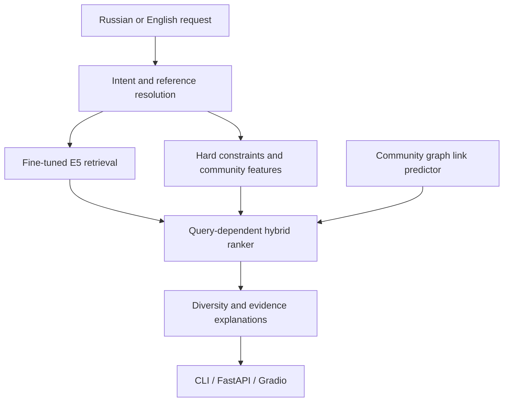

# ScentMatch

Natural-language perfume recommendations backed by a fine-tuned multilingual
encoder, structured constraints, community perception and leakage-safe graph
link prediction.

[Русская версия](README_RU.md)

## Why this project

Perfume recommendations are difficult to infer from notes alone: two fragrances
with similar pyramids may be perceived very differently. ScentMatch combines
catalogue descriptions with community votes about season, performance and
perceived similarity. A user can write a free-form request in Russian or English:

```text
Популярный несладкий мужской аромат на лето,
похожий на Versace Pour Homme
```

The system resolves the reference, applies explicit constraints, retrieves and
reranks 5,000 fragrances, diversifies the result and explains which evidence
supported every recommendation.

## Demo

The application exposes one shared inference service through:

- Gradio UI: `http://127.0.0.1:8000/app`;
- Swagger/OpenAPI: `http://127.0.0.1:8000/docs`;
- CLI: `scentmatch-search`.

The screenshot below is a real Windows run of the reference-aware path. It
shows parsed intent, a resolved catalogue reference and evidence-backed results;
no rankings were mocked or manually composed.


The constraint-only path works without a named reference and explains the
season, longevity, sillage and structured-profile signals used by the ranker.


All screenshots come from the real local model and were captured from the same local inference service used by the CLI and API.

## What is implemented

- deterministic bilingual `QueryIntent` extraction;
- typo-tolerant reference resolution with confidence, margin and abstention;
- fine-tuned `intfloat/multilingual-e5-small` semantic retrieval;
- explicit exclusions for notes and accords;
- query-dependent season, day/night, longevity, sillage and popularity scoring;
- 27,804 vote-aware `reminds_me_of` edges and 70,956 `also_liked` edges;
- portable logistic link predictor for resolved reference queries;
- brand-aware MMR-style result diversification;
- evidence-based explanations without a generative LLM;
- FastAPI, Gradio, CLI, Docker and GitHub Actions;
- reproducible CPU latency/RAM benchmark.

## Architecture



The model, embeddings, community store and graph predictor are loaded once in
`RecommendationService`; all three interfaces therefore return the same ranking.

## Verified evaluation

| Component | Test result | Evaluation scope |
| --- | ---: | --- |
| Intent extraction | 1.000 field accuracy | 18 curated bilingual cases |
| Reference resolution | 1.000 Top-1 | 15 positive cases |
| Correct abstention | 1.000 | 5 ambiguous/negative cases |
| Link prediction | 0.883 ROC-AUC | 893 held-out observed pairs |
| Link prediction | 0.790 Average Precision | 200 positive test pairs |
| E5 pairwise ranking | 0.709 macro accuracy | 96 reference groups |
| ML pairwise ranking | **0.894** macro accuracy | same held-out groups |
| Community coverage | 5,000 / 5,000 | selected catalogue |

The graph split is performed on canonical undirected pairs. Dev/test positive
edges are unavailable to graph features, missing edges are not labelled as
negatives, and node degree was removed after dev ablation exposed hub bias.

These numbers do **not** prove universal subjective recommendation quality. The
free-form ranker still lacks a large expert-judged test set. Full provenance is
documented in [`docs/evaluation.md`](docs/evaluation.md).

## Local installation

Requirements: Python 3.11+, Windows/Linux/macOS, CPU is sufficient. The project
was designed for a 16 GB RAM laptop without a discrete GPU.

This is the recommended way to run ScentMatch on a personal laptop. Docker is
optional and is not required by the application architecture.

```powershell
py -3.11 -m venv .venv
.venv\Scripts\Activate.ps1
python -m pip install --upgrade pip
python -m pip install -e ".[dev,inference,app]"
```

Check that the local model and derived runtime files are present:

```powershell
scentmatch-runtime-check
```

Start the UI and API:

```powershell
scentmatch-app
```

The first start is slower because the encoder and all indexes are loaded into
memory. Subsequent requests reuse the same service.

## REST API

```http
POST /api/v1/recommend
Content-Type: application/json

{
  "query": "Стойкий свежий аромат на лето без сильного шлейфа",
  "top_k": 5
}
```

The generated Swagger UI exposes the same service and returns the parsed intent,
warnings, ranked results, evidence-backed explanations and request latency.


Other endpoints:

| Method | Path | Purpose |
| --- | --- | --- |
| `GET` | `/health` | readiness and catalogue size |
| `GET` | `/api/v1/info` | model/service metadata |
| `POST` | `/api/v1/recommend` | ranked recommendations and explanations |
| `GET` | `/api/v1/perfumes/{id}` | catalogue and community profile |

## CPU benchmark

Run the same 48-query workload on the target machine:

```powershell
scentmatch-benchmark --repeats 3 --warmup 2 --top-k 5
```

It records:

- service cold-load time;
- warm p50/p95/p99 and throughput;
- reference versus non-reference latency;
- latency by query category;
- loaded and peak process RSS;
- OS, Python, CPU count and total RAM.

Outputs:

```text
artifacts/benchmark_v1/benchmark_report.json
artifacts/benchmark_v1/benchmark_report.md
```

The values below come from the preserved benchmark report rather than an
estimate. See [`docs/benchmarking.md`](docs/benchmarking.md) for the protocol.

### Measured laptop performance

Native Windows 10, Python 3.12.4, CPU-only, 12 logical CPUs and 15.3 GB RAM:

| Metric | Result |
| --- | ---: |
| One-time service load | 48.45 s |
| Warm p50, all queries | 163.68 ms |
| Warm p95, all queries | 830.58 ms |
| Warm p50, no reference | 159.16 ms |
| Warm p50, accepted reference | 742.75 ms |
| Sequential throughput | 3.824 query/s |
| Loaded process RSS | 873.81 MB |
| Peak process RSS | 981.56 MB |

The workload contains 48 fixed bilingual queries repeated three times. Reference
queries activate additional graph scoring and therefore form a slower, clearly
reported path. This is an in-process sequential benchmark, not an HTTP load
test. The complete report is available in
[`artifacts/benchmark_v1/benchmark_report.md`](artifacts/benchmark_v1/benchmark_report.md).

## Docker

Docker is provided as a packaging/deployment demonstration, not as the primary
local development environment. The image explicitly installs CPU-only PyTorch
from the official PyTorch wheel index and does not require CUDA/NVIDIA packages.

The local image includes the runtime model and derived artifacts already present
in the project directory:

```powershell
scentmatch-runtime-check
docker compose up --build
```

Then open `http://127.0.0.1:8000/app`. The container runs as a non-root user and
has an HTTP health check with an extended model-loading start period.

Stop and remove the application container after the check:

```powershell
docker compose down
```

ScentMatch has no automatic restart policy. Docker Desktop itself may also be
closed when no other containerized project is in use. The image remains on disk
until explicitly removed with `docker image rm scentmatch:0.7.0`.

If the build cannot reach PyPI and reports an SSL/TLS error, follow
[`docs/deployment.md`](docs/deployment.md). A PyPI
connection failure occurs outside the ScentMatch package and must be fixed in
Docker Desktop networking/proxy settings.

CI builds a code-only image without PyTorch or large runtime files; local
Compose enables CPU inference, sets `REQUIRE_RUNTIME_ASSETS=1` and fails the
build when required files are missing.

Model weights, document embeddings and the derived catalogue are intentionally
kept outside Git. Their expected paths and release options are documented in
[`docs/deployment.md`](docs/deployment.md).

## Tests and CI

```powershell
pytest
ruff check .
```

GitHub Actions runs Ruff and pytest on Python 3.11 and 3.12, then verifies that
the Docker image builds. Model-dependent online inference is not executed in CI;
service, API and UI contracts use deterministic fakes.

## Repository layout

```text
src/scentmatch/          Python package, service, API and retrieval
data/eval/               reproducible query/evaluation sets
docs/                    curated technical documentation
schemas/                 data and judgment contracts
scripts/                 fine-tuning utilities
tests/                   unit and API contract tests
Dockerfile               CPU application image
docker-compose.yml       local one-command deployment
.github/workflows/       CI
```

## Data and responsible use

The project uses two Kaggle datasets derived from Fragrantica:

- [Fragrantica.com Fragrance Dataset](https://www.kaggle.com/datasets/olgagmiufana1/fragrantica-com-fragrance-dataset);
- [Le Decanteur — Fragrantica Perfumes](https://www.kaggle.com/datasets/ledecanteur/fragrantica-perfumes).

The source pages declare CC BY-NC-SA 4.0. ScentMatch is therefore presented as a
non-commercial research/portfolio project. Community pros and cons are
source-provided AI summaries retained only with vote evidence; the UI labels
them explicitly and preserves agreement/vote counts.

## Limitations

- community voters are not a random population sample;
- perfume perception remains subjective;
- link prediction estimates community similarity, not personal preference;
- popularity is a reproducible catalogue proxy, not live store availability;
- price data is historical;
- expert evaluation and online feedback would be required before production use.

## Documentation

- [Data and dataset design](docs/data.md)
- [Modeling and ranking](docs/modeling.md)
- [Evaluation and metric provenance](docs/evaluation.md)
- [CPU benchmark protocol](docs/benchmarking.md)
- [Application, runtime assets and deployment](docs/deployment.md)
