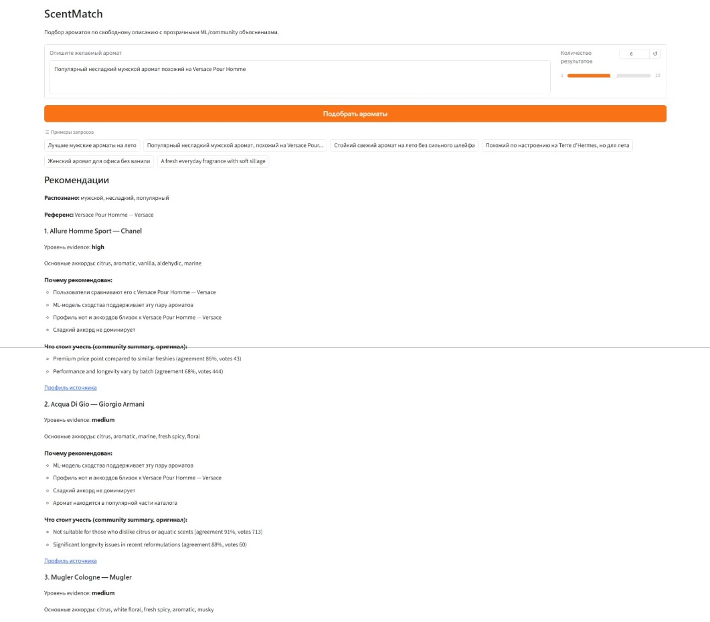
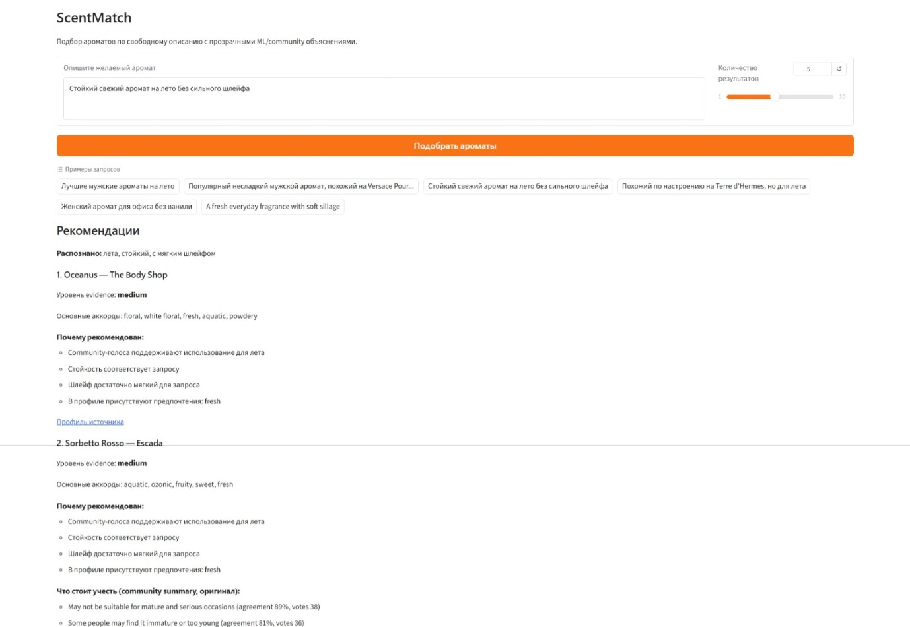
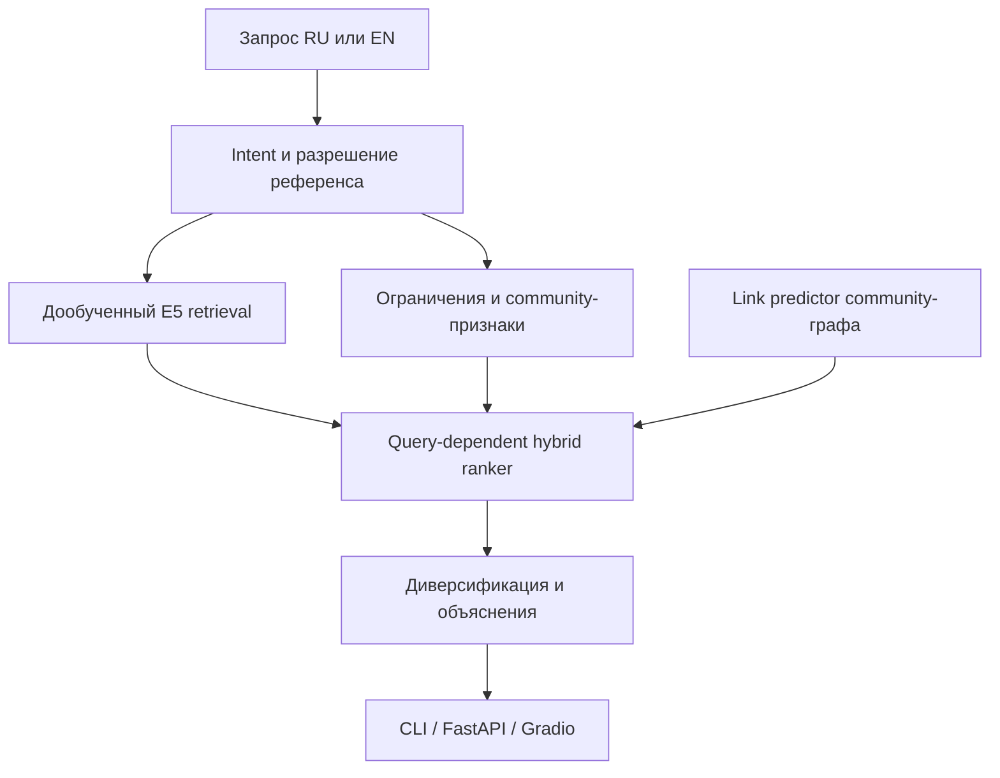
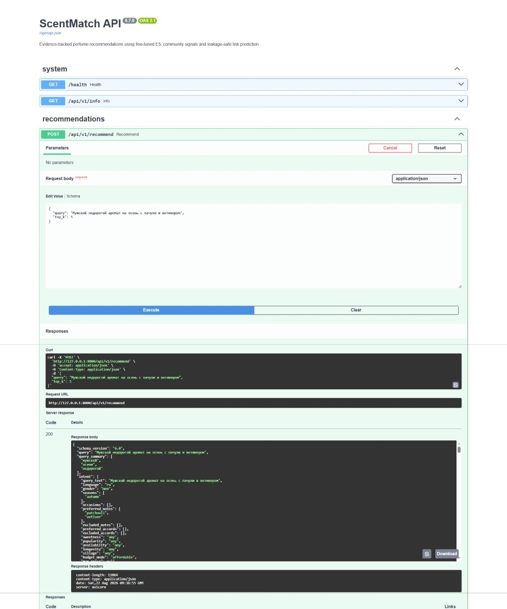

# ScentMatch

Рекомендательная система ароматов по свободному текстовому запросу. Она
объединяет дообученный multilingual encoder, структурированные ограничения,
community-восприятие и leakage-safe link prediction по графу сходства.

[English version](README.md)


## Задача

Аромат нельзя качественно описать только списком нот: похожие пирамиды могут
по-разному ощущаться пользователями. ScentMatch дополняет каталог голосами о
сезонности, стойкости, шлейфе и воспринимаемом сходстве. Пользователь пишет
запрос на русском или английском:

```text
Популярный несладкий мужской аромат на лето,
похожий на Versace Pour Homme
```

Система определяет референс, применяет ограничения, ранжирует каталог из 5 000
ароматов, диверсифицирует top-k и объясняет, какие фактические сигналы поддержали
каждую рекомендацию.

## Демонстрация

- Gradio: `http://127.0.0.1:8000/app`;
- Swagger/OpenAPI: `http://127.0.0.1:8000/docs`;
- CLI: `scentmatch-search`.

Ниже показан реальный Windows-запуск reference-aware сценария: распознанные
признаки, найденный референс и рекомендации с подтверждёнными объяснениями.
Результаты не подменялись mock-данными и не составлялись вручную.



Сценарий без конкретного референса применяет ограничения и объясняет сигналы
сезонности, стойкости, шлейфа и структурного профиля.



Все снимки получены на реальной локальной модели через тот же inference-сервис, который используют CLI и API.

## Реализовано

- bilingual `QueryIntent` без LLM;
- устойчивое к опечаткам разрешение референса с confidence/margin и abstention;
- retrieval на дообученном `intfloat/multilingual-e5-small`;
- явные исключения нот и аккордов;
- query-dependent season/day-night/longevity/sillage/popularity scoring;
- 27 804 связи `reminds_me_of` и 70 956 `also_liked`;
- переносимый logistic link predictor для reference-запросов;
- brand-aware MMR-подобная диверсификация;
- evidence-based объяснения без генеративной LLM;
- FastAPI, Gradio, CLI, Docker и GitHub Actions;
- воспроизводимый benchmark latency/RAM на CPU.

## Архитектура



`RecommendationService` один раз загружает encoder, embeddings, community store
и link predictor. CLI, API и UI используют один ranking-код.

## Проверенные метрики

| Компонент | Test-результат | Объём проверки |
| --- | ---: | --- |
| Intent extraction | 1,000 field accuracy | 18 bilingual-кейсов |
| Reference resolution | 1,000 Top-1 | 15 positive-кейсов |
| Correct abstention | 1,000 | 5 ambiguous/negative-кейсов |
| Link prediction | 0,883 ROC-AUC | 893 observed test-пары |
| Link prediction | 0,790 Average Precision | 200 positive test-пар |
| E5 pairwise ranking | 0,709 macro accuracy | 96 reference-групп |
| ML pairwise ranking | **0,894** macro accuracy | те же группы |
| Community coverage | 5 000 / 5 000 | выбранный каталог |

Пары разделяются как неориентированные. Dev/test positive edges отсутствуют в
graph features; отсутствие ребра не считается negative; degree-признаки удалены
после dev-ablation из-за hub bias.

Метрики не доказывают универсальное субъективное качество рекомендаций. У
free-form ranker пока нет большого expert-judged test set. Подробнее:
[`docs/evaluation.md`](docs/evaluation.md).

## Локальный запуск

Нужен Python 3.11+. Проект рассчитан на CPU и ноутбук с 16 ГБ RAM без дискретной
GPU.

Это рекомендуемый вариант для личного ноутбука. Docker является дополнительной
демонстрацией упаковки и не требуется архитектуре приложения.

```powershell
py -3.11 -m venv .venv
.venv\Scripts\Activate.ps1
python -m pip install --upgrade pip
python -m pip install -e ".[dev,inference,app]"
scentmatch-runtime-check
scentmatch-app
```

Откройте:

- UI: `http://127.0.0.1:8000/app`;
- Swagger: `http://127.0.0.1:8000/docs`;
- health check: `http://127.0.0.1:8000/health`.

Первый запуск дольше: модель и индексы загружаются в память. Дальнейшие запросы
используют уже созданный сервис.

## API

```http
POST /api/v1/recommend
Content-Type: application/json

{
  "query": "Стойкий свежий аромат на лето без сильного шлейфа",
  "top_k": 5
}
```

Swagger использует тот же сервис и возвращает распознанный intent,
предупреждения, ранжированные результаты, объяснения и latency запроса.



| Метод | Путь | Назначение |
| --- | --- | --- |
| `GET` | `/health` | readiness и размер каталога |
| `GET` | `/api/v1/info` | сведения о сервисе и модели |
| `POST` | `/api/v1/recommend` | рекомендации с объяснениями |
| `GET` | `/api/v1/perfumes/{id}` | профиль аромата |

## Benchmark latency/RAM

```powershell
scentmatch-benchmark --repeats 3 --warmup 2 --top-k 5
```

Команда прогоняет 48 запросов и измеряет:

- cold load сервиса;
- warm p50/p95/p99 и throughput;
- reference/non-reference latency;
- latency по категориям;
- loaded и peak RSS;
- характеристики среды.

Результаты:

```text
artifacts/benchmark_v1/benchmark_report.json
artifacts/benchmark_v1/benchmark_report.md
```

Значения ниже взяты из сохранённого benchmark report, а не рассчитаны
теоретически. Протокол: [`docs/benchmarking.md`](docs/benchmarking.md).

### Результат на целевом ноутбуке

Нативный Windows 10, Python 3.12.4, только CPU, 12 логических процессоров и
15,3 ГБ RAM:

| Метрика | Результат |
| --- | ---: |
| Однократная загрузка сервиса | 48,45 с |
| Warm p50, все запросы | 163,68 мс |
| Warm p95, все запросы | 830,58 мс |
| Warm p50, без референса | 159,16 мс |
| Warm p50, принятый референс | 742,75 мс |
| Последовательная пропускная способность | 3,824 запроса/с |
| RSS после загрузки | 873,81 МБ |
| Peak RSS | 981,56 МБ |

Нагрузка состоит из 48 фиксированных RU/EN-запросов, повторённых три раза.
Reference-запросы дополнительно используют graph scoring, поэтому это отдельный
более медленный путь. Это последовательный in-process benchmark, а не HTTP load
test. Полный отчёт:
[`artifacts/benchmark_v1/benchmark_report.md`](artifacts/benchmark_v1/benchmark_report.md).

## Docker

Docker нужен только как демонстрация packaging/deployment, а не как основной
режим локальной разработки. Образ явно устанавливает CPU-only PyTorch из
официального индекса PyTorch и не скачивает CUDA/NVIDIA-пакеты.

```powershell
scentmatch-runtime-check
docker compose up --build
```

Контейнер запускается не от root и имеет HTTP healthcheck. Локальная Compose-
сборка требует model/runtime assets и завершается ошибкой при их отсутствии.

После проверки остановите и удалите контейнер приложения:

```powershell
docker compose down
```

У ScentMatch больше нет политики автоматического перезапуска. Если другие
контейнерные проекты не используются, Docker Desktop также можно полностью
закрыть. Образ останется на диске до явной команды
`docker image rm scentmatch:0.7.0`.

Если сборка не подключается к PyPI и сообщает об SSL/TLS, используйте
[`docs/deployment.md`](docs/deployment.md). Такая ошибка
возникает на уровне сети/proxy Docker Desktop до установки ScentMatch.

Веса модели, document embeddings и производный каталог не хранятся в Git.
Ожидаемые пути и варианты публикации описаны в
[`docs/deployment.md`](docs/deployment.md).

## Тесты и CI

```powershell
pytest
ruff check .
```

GitHub Actions запускает Ruff и pytest на Python 3.11/3.12, затем проверяет
облегчённый Docker build без PyTorch. Model-dependent inference в CI не
запускается: service/API/UI контракты проверяются через deterministic fakes.

## Данные и ограничения лицензии

- [Fragrantica.com Fragrance Dataset](https://www.kaggle.com/datasets/olgagmiufana1/fragrantica-com-fragrance-dataset);
- [Le Decanteur — Fragrantica Perfumes](https://www.kaggle.com/datasets/ledecanteur/fragrantica-perfumes).

Источники заявляют CC BY-NC-SA 4.0, поэтому текущий проект предназначен для
некоммерческого исследования и портфолио. Community pros/cons — source-provided
AI summaries, сохранённые только при наличии голосов; интерфейс явно указывает
их происхождение и agreement.

## Основные ограничения

- community voters не являются случайной выборкой пользователей;
- восприятие ароматов субъективно;
- link predictor оценивает community-сходство, а не личный вкус;
- popularity не доказывает актуальную доступность;
- цены исторические;
- перед production потребуются экспертная оценка и online feedback.

## Документация

- [Данные и устройство датасета](docs/data.md)
- [Модели и ranking](docs/modeling.md)
- [Evaluation и происхождение метрик](docs/evaluation.md)
- [CPU benchmark](docs/benchmarking.md)
- [API, runtime assets, Docker и CI](docs/deployment.md)
